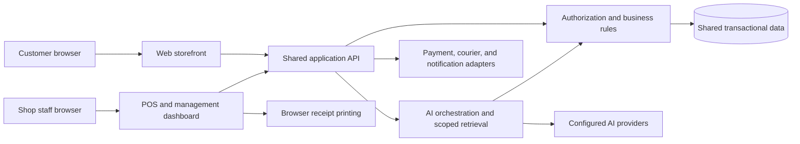

# Software Requirements Specification (SRS)

## DeshiWear — Web Store, Shop Management, and AI Integration

| Document field | Value |
| --- | --- |
| Version | 1.0 |
| Date | 5 September 2026 |
| Status | Draft for stakeholder review |
| Project | DeshiWear, a Bangladeshi fashion retail platform |
| Intended readers | Business owner, project supervisor, developers, designers, testers, and shop staff |
| Basis | Review of the current repository and the requested expansion to web and shop control with AI |

## 1. Introduction

### 1.1 Purpose

This document specifies the requirements for extending DeshiWear into a unified system for online shopping, physical-shop operations, and AI assistance. It defines the expected behavior, access controls, data, integrations, quality targets, and acceptance criteria needed to plan, implement, and verify the system.

“Shop control” is interpreted as physical-store point of sale (POS), inventory, purchasing, returns, staff access, and operational reporting, alongside administration of the website. This is a proposed scope assumption, not a description of functionality already completed.

### 1.2 Business objectives

- Let customers discover and purchase Bangladeshi fashion through a responsive website.
- Let shop staff sell the same catalog at a physical counter.
- Maintain consistent stock, prices, customer records, and sales records across channels.
- Give the owner visibility into sales, collections, returns, stock, and purchasing.
- Use AI to help customers find products and help staff understand business information.
- Keep financial and inventory changes accountable through permissions and audit records.

### 1.3 Scope

The target system includes a customer website, a staff and owner dashboard, a browser-based POS, a shared backend and database, and server-managed AI integrations. Bangladesh is the initial delivery market; Bangladeshi Taka (BDT, ৳) is the initial currency.

The first release assumes one business and one physical shop, with location identifiers in inventory and transactions so additional locations can be introduced later. Staff use an internet-connected desktop or tablet. Customers use desktop or mobile browsers.

Full accounting, payroll, manufacturing, a multi-seller marketplace, native mobile applications, international shipping, virtual try-on, autonomous purchasing, and offline sale completion are outside the initial scope. Operational expense and gross-margin reports are included; statutory accounts are not.

### 1.4 Terms and requirement notation

| Term | Meaning |
| --- | --- |
| SKU | Unique identifier for a sellable product variant, such as a particular size and color |
| POS | Point of sale used by staff to record counter sales |
| COD | Cash on Delivery |
| RBAC | Role-based access control |
| On-hand stock | Units physically held at a location, including reserved and quarantined units |
| Available stock | On-hand units minus reserved and quarantined units |
| Reservation | Units allocated to an order but not yet dispatched |
| Stock ledger | Append-only record of receipts, sales, dispatches, returns, transfers, and adjustments |
| Grounded AI answer | Answer supported by approved catalog, policy, or authorized business records |
| Idempotency | Repeating the same request does not create duplicate business effects |

Each requirement has a unique ID. **Must** means required for the indicated release; **Should** means desirable and explicitly deferrable; **Could** means optional. “Shall” defines required behavior if that requirement is included in a release. **R1** is the initial integrated web/shop release, **R2** adds integrations and business AI, and **R3** covers optional expansion. Priorities and targets below are proposed planning commitments, not measured properties of the current application.

## 2. Current project baseline

This baseline reflects source inspection, not a runtime acceptance test. A feature marked present may still need validation or extension to satisfy this SRS.

| Area | Evidence in current project | Gap relative to target |
| --- | --- | --- |
| Technology | React, Vite, Tailwind CSS, Redux Toolkit; Node.js, Express, MongoDB, Mongoose | Deployment, operational monitoring, and production recovery requirements need implementation and verification |
| Customer access | Registration, login, JWT authentication, profile; `customer` and `admin` roles | Password recovery, staff roles, account lifecycle, and finer permissions |
| Storefront | Collections, search, filtering, sorting, product details, featured and similar products | Variant-level availability, pagination, and consistent published-product visibility |
| Cart | Guest and signed-in carts, quantity changes, removal, and guest-cart merge | Strong quantity/variant validation and final stock/price revalidation |
| Checkout | Authenticated checkout, COD UI, order creation, order history, and order details | Atomic stock allocation, duplicate-submission protection, payment verification, and return workflows |
| Delivery | Code uses ৳60 inside Dhaka, ৳120 outside, and free delivery from ৳2,000 | Configurable service areas and rates rather than a free-text city match |
| Administration | Product CRUD, stock count editing, order status editing, user management, basic totals | POS, purchasing, stock ledger, staff separation, expenses, and reconciled reports |
| Inventory | One product-level `countInStock`; sizes and colors stored as lists | No variant/location stock model; inspected order creation does not reserve or decrement stock |
| Order settlement | Marking an order delivered also marks it paid | Separate delivery, customer collection, and courier remittance records |
| Revenue dashboard | Sums `totalPrice` across all orders | Separate booked orders, realized sales, cancellations, refunds, and cash collections |
| AI assistant | “Deshi Sohayok” chat widget; catalog keyword retrieval; Bangla/English/Banglish prompt; Groq with Gemini fallback when configured | Provider availability and response quality are unverified; stronger grounding, access controls, limits, and staff AI are needed |
| Database | Configured MongoDB or embedded development MongoDB | Managed production persistence, atomic operations, migrations, and tested backups |

### 2.1 Repository references

- [Project overview and setup](../README.md)
- [Frontend routes](../frontend/src/App.jsx)
- [Product model](../backend/models/Product.js), [user model](../backend/models/User.js), [order model](../backend/models/Order.js), and [cart model](../backend/models/Cart.js)
- [Product API](../backend/routes/productRoutes.js), [cart API](../backend/routes/cartRoutes.js), [order API](../backend/routes/orderRoutes.js), and [admin API](../backend/routes/adminRoutes.js)
- [Checkout screen](../frontend/src/components/pages/CheckoutPage.jsx)
- [Chat API](../backend/routes/chatRoutes.js), [AI implementation](../backend/utils/aiChat.js), and [chat widget](../frontend/src/components/Common/ChatWidget.jsx)
- [Database configuration](../backend/config/db.js)

## 3. Users and permissions

All staff roles except the existing administrator are proposed additions. One person may hold multiple explicitly assigned roles; permissions shall be enforced by the backend on every protected operation.

| Actor | Allowed activities | Restrictions |
| --- | --- | --- |
| Visitor | Browse published products, use a guest cart, ask public product/policy questions | No customer records; sign-in required for R1 web checkout |
| Customer | Manage own profile, place orders, view own orders, request eligible returns | No access to another customer's records or staff functions |
| Cashier | Open own shift, create POS sales, issue receipts, submit return requests | No cost reports, role changes, unrestricted discounts, or refund approval |
| Inventory staff | Receive authorized purchases, count stock, request adjustments | No staff administration or cash/refund operations |
| Shop manager | Manage assigned-shop operations, approve permitted discounts/returns/adjustments, view shop reports | Cannot assign owner privileges or change global security settings |
| Owner/administrator | Configure business rules, manage catalog and staff, approve purchasing, view all reports and audit records | Cannot silently alter historical sales or erase audit records |
| Accountant | View/export financial reports, record approved expenses, reconcile settlements | Cannot edit catalog stock or grant permissions |
| Support staff | View minimum customer/order details needed for service and manage support requests | No full financial reports, bulk customer exports, or payment credentials |
| AI service | Read public data or explicitly authorized, scoped business data through backend tools | No direct unrestricted database access or autonomous business mutations |

## 4. Functional requirements — customer website

| ID | Priority / release | Requirement | Acceptance criterion |
| --- | --- | --- | --- |
| WEB-01 | Must / R1 | The system shall let customers register, sign in, sign out, view/update their profile, and recover a password through a verified account channel. | Duplicate identities are rejected; expired or reused recovery links fail; a customer can update only their own permitted fields. |
| WEB-02 | Must / R1 | The website shall display published collections and products, with category, size, color, material, price, and availability filters, text search, sorting, and pagination. | Combined filters return matching published products; direct requests cannot reveal unpublished products; price filters and sorting use the displayed effective price. |
| WEB-03 | Must / R1 | Product details shall show images, description, effective price, selectable variants, variant availability, and size information. | An unavailable or nonexistent size/color combination cannot be added to an order; stock is not inferred from independent size/color lists. |
| WEB-04 | Must / R1 | Visitors and customers shall add, update, and remove cart items; sign-in shall merge the guest cart into the customer's cart. | Matching variants combine once, invalid quantities are rejected, and changed availability is shown without silently substituting a variant. |
| WEB-05 | Must / R1 | Checkout shall validate recipient name, Bangladesh phone number, address, service area, cart contents, and allowed payment method on the server. | Empty carts, unsupported addresses/methods, invalid quantities, and manipulated client prices are rejected with actionable errors. |
| WEB-06 | Must / R1 | Checkout shall show an authoritative item subtotal, discounts, delivery, configured tax if applicable, and final total before confirmation. | A server-side price or fee change requires the customer to review the revised total before the order is committed. |
| WEB-07 | Must / R1 | COD order placement shall create one order, reserve stock, preserve item/price snapshots, and clear purchased cart lines as one recoverable business operation. | Repeated submission yields the same order; a failure leaves no orphan reservation or lost cart; concurrent orders cannot oversell. |
| WEB-08 | Must / R1 | Customers shall receive an on-screen order reference and view their order history, payment state, and fulfillment timeline. | The customer's new order is visible immediately after success, and another customer's identifier does not grant access. |
| WEB-09 | Must / R1 | Customers shall request cancellation before dispatch and request eligible returns or exchanges after fulfillment. | Allowed requests enter an auditable workflow; dispatch/cancellation races are resolved atomically; ineligible requests show the policy reason. |
| WEB-10 | Must / R1 | The website shall display approved delivery, return, privacy, and contact information and provide access to the AI assistant. | Policy content and the AI's policy source share a versioned source of truth; support contact remains available when AI fails. |
| WEB-11 | Should / R2 | The website shall offer saved addresses, wishlists, and purchase-verified product reviews with moderation. | Customers control only their own saved data; review eligibility is checked; unpublished reviews do not affect public ratings. |
| WEB-12 | Must / R2 | The system shall support an approved digital payment gateway in addition to COD. | Verified provider confirmation is required to mark payment successful; cancelled, failed, and duplicate callbacks do not duplicate orders or collections. |

## 5. Functional requirements — shop control

### 5.1 Catalog, inventory, and purchasing

| ID | Priority / release | Requirement | Acceptance criterion |
| --- | --- | --- | --- |
| SHOP-01 | Must / R1 | Authorized staff shall create/edit/archive products and variants, categories, prices, images, and publication state. Each variant shall have a unique SKU and optional unique barcode. | Duplicate identifiers and invalid prices are rejected; archiving preserves historical transaction references. |
| SHOP-02 | Must / R1 | The system shall maintain on-hand, reserved, quarantined, and available stock per variant and location for both sales channels. | A committed POS sale or web reservation changes availability for subsequent requests immediately; online and shop screens refresh within five seconds under the agreed load. |
| SHOP-03 | Must / R1 | Every stock-affecting event shall create an append-only ledger entry with quantity, variant, location, actor, reason, source reference, and timestamp. | Ledger movements reconcile with stock balances; corrections use reversal or adjustment entries instead of overwriting history. |
| SHOP-04 | Must / R1 | Authorized staff shall count inventory and submit discrepancies for manager approval. | Approval posts the difference exactly once; concurrent movements are accounted for; the original count and approval remain visible. |
| SHOP-05 | Must / R1 | Managers shall configure low-stock thresholds and view items needing replenishment. | A variant below its available-stock threshold appears in the low-stock report and clears when replenished above the threshold. |
| SHOP-06 | Must / R1 | The system shall maintain supplier records and purchase orders with item quantities, unit costs, expected delivery, and draft/approved/part-received/received/cancelled states. | Only approved orders can be received; cancelled quantities cannot be received; all changes identify the responsible staff member. |
| SHOP-07 | Must / R1 | Inventory staff shall record full or partial goods receipts, discrepancies, and damaged units against purchase orders. | Received sellable units increase availability once; damaged units enter quarantine; over-receipt requires explicit approval. |
| SHOP-08 | Must / R1 | The system shall retain purchase costs, use a documented moving weighted-average cost for new receipts, and snapshot cost on sale fulfillment. | Later supplier cost changes do not rewrite past margins; returns reverse the original sale cost; missing historical costs are labeled unknown. |
| SHOP-09 | Should / R3 | Staff shall transfer stock between locations using dispatch and receipt records. | In-transit units cannot be sold at either location; partial receipts and discrepancies remain traceable. |

### 5.2 Point of sale and cash operations

| ID | Priority / release | Requirement | Acceptance criterion |
| --- | --- | --- | --- |
| POS-01 | Must / R1 | A cashier shall open a register shift with an opening cash amount and create a sale by barcode or product search. | The sale records cashier, shop, register, shift, exact variants, and quantities; ambiguous scans require selection. |
| POS-02 | Must / R1 | POS shall calculate totals, configured discounts/taxes, tendered cash, and change on the server. | For a ৳1,250 cash sale with ৳1,500 tendered, change is ৳250; insufficient tender and unauthorized discounts are rejected. |
| POS-03 | Must / R1 | Completing a cash sale shall atomically record the transaction, payment, stock movement, and a unique receipt number. | Two requests for the final available unit produce at most one successful sale; retries cannot create a second receipt or stock deduction. |
| POS-04 | Must / R1 | Staff shall print and reprint receipts containing store details, receipt number, date, cashier, items, totals, and payment breakdown. | A printer failure leaves the completed sale intact; reprinting uses the same receipt number and records a reprint event. |
| POS-05 | Must / R1 | POS shall allow anonymous walk-in sales and optionally link a consenting customer by a verified or staff-confirmed identifier. | A walk-in sale requires no customer account; unrelated customer history is not exposed during lookup. |
| POS-06 | Must / R1 | Cashiers shall hold/resume draft baskets and void a basket before completion; completed sales shall use a return or reversal workflow. | Held baskets do not reserve stock in R1; resuming rechecks stock and prices; completed sales cannot be deleted. |
| POS-07 | Must / R1 | Shift close shall compare expected cash with counted cash, record variance and reason, and require manager review of discrepancies. | Expected cash equals opening cash plus cash sales and approved cash-ins, minus cash refunds and approved cash-outs; noncash payments are excluded. |
| POS-08 | Must / R1 | POS shall show connection state and require backend confirmation before showing a sale as complete. | On a timeout, staff can resolve the existing transaction by request reference; reconnection does not silently submit a second sale. |
| POS-09 | Should / R2 | POS shall support approved digital tenders and split payments with reconciliation references. | A sale completes only when the verified tender total equals the amount due; failed components are recoverable without duplicate charging. |

### 5.3 Orders, returns, administration, and reports

| ID | Priority / release | Requirement | Acceptance criterion |
| --- | --- | --- | --- |
| OPS-01 | Must / R1 | Staff shall view online and counter sales in one workspace, filter by channel/date/status/customer, and inspect line items and history. | Each record identifies its channel and location; counts and exports use the same filters as the screen. |
| OPS-02 | Must / R1 | Authorized staff shall confirm, pack, dispatch, and complete web orders through validated state transitions. | Illegal transitions are rejected; dispatch records consume the reservation; delivery does not automatically prove courier remittance. |
| OPS-03 | Must / R1 | Managers shall review item-level return/exchange requests against configurable policy and original sale quantities. | Returned quantities cannot exceed fulfilled quantities minus earlier accepted returns; decisions include a reason and actor. |
| OPS-04 | Must / R1 | Received returns shall be inspected and classified as sellable or quarantined; refunds and exchanges shall reference the original sale. | Refunds cannot exceed the remaining refundable amount; stock increases only on physical receipt; exchange price differences are collected or refunded explicitly. |
| OPS-05 | Must / R1 | Owners shall manage staff roles, location assignments, account activation, and approval limits. | Deactivated staff lose access on subsequent requests; unauthorized role changes fail; the last active owner cannot be removed. |
| OPS-06 | Must / R1 | The dashboard shall report sales, discounts, returns, tax, delivery charges, collections, unsettled COD, stock value, and gross margin, separated by channel and date. | Report definitions follow Section 8; draft/cancelled orders do not inflate realized sales; unknown costs are disclosed rather than treated as zero. |
| OPS-07 | Must / R1 | Authorized finance staff shall record expenses and reconcile COD collections/remittances with order and courier references. | Partial settlements, fees, and differences are visible; adjustments preserve the original record and approver. |
| OPS-08 | Must / R1 | Authorized users shall export filtered sales, stock, purchasing, and settlement reports to CSV and printable views. | Export totals match the selected report; customer and cost fields follow the exporter's permissions. |
| OPS-09 | Must / R1 | Owners shall configure delivery areas/rates, return windows, approval limits, receipt details, and tax settings where applicable. | Changes record an effective date and actor, affect subsequent quotations, and do not alter completed transaction snapshots. |
| OPS-10 | Must / R1 | The system shall audit privileged changes, approvals, refunds, stock adjustments, exports, and access-control changes. | Audit entries include actor, timestamp, target, action, and relevant before/after values without passwords or secrets; normal staff cannot alter them. |
| OPS-11 | Should / R2 | Support staff shall manage customer service requests linked to orders and AI handoffs. | Requests have an owner, status, timestamps, and resolution notes; only permitted customer details are visible. |

## 6. Functional requirements — AI integration

### 6.1 AI scope and architecture

R1 extends the existing **Deshi Sohayok** shopping assistant. R2 introduces staff assistance, catalog drafting, and forecasting. AI outputs are suggestions or explanations; backend rules remain responsible for prices, stock, permissions, payments, and transaction state.

The existing code contains Groq and Gemini adapters. This SRS does not assume their configured models are currently available or production-ready. Provider/model selection shall be configurable and validated during implementation; no new provider subscription is selected by this document.

| ID | Priority / release | Requirement | Acceptance criterion |
| --- | --- | --- | --- |
| AI-01 | Must / R1 | The customer assistant shall answer in Bangla, English, or Banglish according to the conversation and identify itself as AI. | Language evaluation covers all three styles; the assistant does not claim to be a human employee. |
| AI-02 | Must / R1 | The assistant shall retrieve published catalog information and approved store policies before giving product or policy answers. | Returned product links identify real published products; prices and availability come from server data; unsupported answers say information is unavailable. |
| AI-03 | Must / R1 | The assistant shall suggest products using explicit customer preferences such as budget, category, occasion, size, and color. | Suggestions satisfy requested hard constraints or explain that no match exists; unavailable variants are not described as purchasable. |
| AI-04 | Must / R1 | AI recommendations shall use structured product references with server-rendered price and stock fields, revalidated when opened or added to cart. | Invented or unpublished IDs are discarded; generated prose cannot override displayed price or checkout validation. |
| AI-05 | Must / R1 | The AI service shall limit input size, roles, history, requests, and output size, with configured timeouts and a safe fallback when providers fail. | Oversized or invalid messages are rejected; repeated requests are rate-limited; provider errors show a plain support message without keys, model internals, or stack traces. |
| AI-06 | Must / R1 | User messages and retrieved content shall be treated as untrusted data; only server-defined instructions and authorized tools shall govern AI access. | Attempts to inject privileged roles, expose secrets, retrieve other customers' orders, or trigger unauthorized mutations fail in the release evaluation. |
| AI-07 | Must / R1 | The system shall minimize data sent to AI providers, keep keys on the server, disclose AI processing, and make retained chat history configurable. | Passwords, tokens, full payment credentials, and unnecessary contact/address fields are excluded; retained conversations follow configured deletion rules. |
| AI-08 | Must / R1 | Operators shall track AI request count, latency, error rate, provider usage, estimated cost where available, and user feedback without logging secrets. | A configurable daily usage limit can disable further AI calls while browsing, checkout, and POS remain operational. |
| AI-09 | Must / R2 | Signed-in customers shall ask about their own order status through an authorized read-only order lookup. | Ownership is checked before retrieval; guessing an order ID cannot expose another customer's data; answers show the record's update time. |
| AI-10 | Must / R2 | Authorized staff shall ask business questions such as today's net sales, low-stock items, or unsettled COD using approved read-only report tools. | All numbers originate from deterministic report queries and include date range, channel/location scope, and data timestamp; no unrestricted model-generated database query is executed. |
| AI-11 | Should / R2 | AI shall draft product descriptions, tags, and Bangla/English translations for staff review. | Drafts remain unpublished until an authorized user approves them; AI cannot invent verified material, origin, or stock facts. |
| AI-12 | Should / R2 | AI-assisted forecasting shall propose demand and reorder quantities from sales history, stockouts, lead times, and explicitly configured seasonal events. | Forecasts show horizon, source period, uncertainty, and data limitations; insufficient history uses a labeled rule-based suggestion; no purchase order is submitted automatically. |
| AI-13 | Could / R3 | The system shall offer visual product search and personalized recommendations when enabled by the owner and permitted by the customer's preferences. | Uploaded images have size/type and deletion controls; personal history is used only for the enabled purpose; nonpersonalized search remains available. |

### 6.2 AI evaluation and release gates

- **AI-QA-01 (Must / R1):** Maintain at least 90 reviewed evaluation conversations: 30 each in Bangla, English, and Banglish. Include budget/size constraints, unavailable items, policy questions, ambiguous requests, prompt injection, and provider failure.
- **AI-QA-02 (Must / R1):** At least 90% of evaluation responses shall be rated correct and useful against expected catalog/policy facts, with at least 85% passing in each language group. Every displayed product ID and structured price/stock field shall match the reference data. Any observed unauthorized disclosure or mutation blocks release.
- **AI-QA-03 (Must / R1):** Repeat the evaluation when changing the model, prompt, retrieval logic, or tool permissions. Record configuration versions and results so a failing change can be rolled back.
- **AI-QA-04 (Must / R2):** Staff AI numerical answers shall match the underlying report outputs on the approved test cases. Forecasts shall be backtested against a seasonal or recent-average baseline; deploy a learned forecast only if it improves the chosen error measure on the agreed holdout period. Otherwise retain the labeled baseline.

## 7. Core use cases

| Use case | Actor and precondition | Main flow | Exception and outcome |
| --- | --- | --- | --- |
| UC-01: Online COD purchase | Customer has a valid session and cart | Review variants → enter address → receive final quote → confirm → reserve stock and create order → show reference | Stock/price changes require review; duplicate confirmation returns the existing result; failed creation preserves recoverable cart contents. |
| UC-02: Counter sale | Cashier has an open shift | Scan/select variants → review totals → accept cash → commit sale → print receipt | Final-unit conflict blocks overselling; timeout is resolved by transaction reference; printer failure permits reprint. |
| UC-03: Receive purchase | Inventory staff has an approved purchase order | Enter received quantities → classify damage → confirm receipt → update ledger and costs | Duplicate receipt is rejected; excess quantity needs approval; damaged units remain unavailable. |
| UC-04: Return or exchange | Original fulfilled sale exists | Request → verify eligibility → approve → receive/inspect goods → refund or create linked replacement sale | Excess return quantity and excess refund are rejected; refund failure remains pending and does not create a second refund on retry. |
| UC-05: AI product discovery | Visitor or customer opens chat | State need → retrieve catalog/policy → clarify missing constraints → display grounded suggestions → open product | No match is explained; unavailable providers show fallback/support access; checkout revalidates all facts. |
| UC-06: Staff business query | Authorized staff member is signed in | Ask a sales/stock question → validate scope → run approved report → explain result with filters and timestamp | Missing scope triggers clarification; unauthorized metrics are withheld; insufficient data is stated. |
| UC-07: End-of-day reconciliation | Cashier closes shift; manager reviews | Count cash → compare expected amount → explain variance → approve close → review channel sales and COD settlements | Unexplained differences remain flagged; closing a shift does not mark unsettled COD as received. |

## 8. Business rules and transaction states

| ID | Rule |
| --- | --- |
| BR-01 | Monetary calculations shall use integer minor units or fixed-precision decimal arithmetic. Display BDT consistently and round only according to a documented rule. |
| BR-02 | Initial delivery defaults are ৳60 inside Dhaka, ৳120 outside Dhaka, and free delivery for an eligible merchandise subtotal of at least ৳2,000. The target free-delivery threshold uses the subtotal after merchandise discounts and before tax/delivery; the owner may configure future rules. |
| BR-03 | Delivery areas shall be selected from configured service areas. A city string containing “Dhaka” is not sufficient to determine eligibility. |
| BR-04 | Sellable variant quantities shall be positive whole units in R1. Fractional fabric sales by meter are deferred; fabric can initially be sold as defined fixed-length units. Available stock shall never be negative. |
| BR-05 | Carts and held POS baskets shall not reserve stock. A confirmed COD order reserves units immediately. A pending digital payment in R2 reserves units for a configurable period, initially 15 minutes. Expiry/cancellation releases reservations once. |
| BR-06 | Dispatch shall reduce on-hand and reserved units by the same shipped quantity. A completed POS sale shall reduce on-hand units directly. Returned sellable units increase on-hand only after receipt and inspection; damaged returns increase quarantined stock. |
| BR-07 | R1 shall fulfill each web order from one location with one dispatch. Partial web fulfillment and multi-location order splitting are deferred; partial purchase receipts and item-level customer returns are supported. |
| BR-08 | Paid orders shall retain payment and fulfillment as separate states. COD delivery may record customer collection, but courier remittance requires a separate settlement event. |
| BR-09 | Prices, discounts, cost basis, tax, delivery rules, and item descriptions applicable to a completed transaction shall be snapshotted. Corrections use traceable adjustments, returns, or reversals. |
| BR-10 | Realized merchandise sales shall include completed POS sales and delivered web items. Net merchandise sales equal realized merchandise value minus merchandise discounts and accepted return credits. Tax, delivery charges, payment collections, and pending refunds shall be reported separately. |
| BR-11 | Gross margin shall equal net merchandise sales minus the corresponding cost of goods sold, with original cost reversed for accepted returns. Operational expenses and courier/payment fees shall be reported separately; this is not a statutory profit statement. |
| BR-12 | Users shall not approve their own restricted discounts, refunds, or stock adjustments unless an explicit owner permission allows it; the system shall record any such owner override. |
| BR-13 | Report timestamps shall be stored in UTC and displayed/grouped using Asia/Dhaka business dates by default. Date filters shall define their inclusive start and exclusive end consistently. |
| BR-14 | AI shall not independently change prices, stock, orders, customer permissions, or financial records. Suggestions that become business actions shall pass the same authorization and approval workflow as manual actions. |
| BR-15 | If a digital payment succeeds after its reservation expires, the system shall either allocate stock and confirm once or flag the payment for reconciliation/refund. It shall not confirm an unfulfillable order or lose the payment record. |

### 8.1 Proposed lifecycle model

Fulfillment, payment, and returns shall be tracked separately; one status field shall not represent all three.

| Record | Allowed normal progression | Required exceptions |
| --- | --- | --- |
| Web fulfillment | Pending confirmation → Confirmed → Packed → Shipped → Delivered | Cancellation allowed before dispatch; failed delivery enters a return-to-origin workflow; dispatched stock is not restored until physically received. |
| Payment | Unpaid → Pending (digital) → Paid → Partially refunded → Refunded | Failed/expired attempts are retained; refund attempts can be pending/failed; retries must not duplicate collections or refunds. |
| COD settlement | Not collected → Collected by courier → Partially remitted → Remitted | Disputed amounts and courier fees are recorded separately; fulfillment alone cannot advance remittance. |
| POS sale | Draft/held → Completed | Draft may be voided; completed sale is corrected through a linked return or reversal. |
| Customer return | Requested → Approved → Received → Inspected → Resolved | May be rejected with reason; resolution records item disposition and refund/exchange obligation, while actual refund settlement remains in payment records. |

Legacy `Processing` orders require reconciliation before mapping to confirmed/reserved orders; existing `Shipped`, `Delivered`, and `Cancelled` values require review against stock and payment evidence. Legacy `isPaid` alone is not evidence of courier remittance.

## 9. Data requirements

The table describes logical entities; final collection boundaries and indexes belong to implementation design.

| Entity | Minimum information and relationships |
| --- | --- |
| User / Role / Permission | Identity, credential hash, activation state, role/permission assignments, shop scope, recovery/session metadata |
| Customer / Address | Optional link to user, contact details, consent/preferences, saved addresses; POS customer link may be absent |
| Product / Variant | Product content and publication state; variant SKU, barcode, size/color, price, cost basis, archive state |
| Location / Register / Shift | Shop identity, register identity, cashier, opening/closing timestamps, cash balances, approval |
| InventoryBalance / StockMovement / Reservation | Variant and location references, stock buckets, source transaction, expiry where applicable, actor/reason, deduplication reference |
| Cart | Customer or secure guest ownership, variant lines and quantities, last quoted prices; never authoritative for final totals |
| Sale / Order / LineItem | Channel, location, customer if any, immutable item/price/cost snapshots, totals, fulfillment events, original request key |
| Payment / Refund / Settlement | Sale reference, method, amount, status, provider or receipt reference, settlement fees, callback/retry references |
| Supplier / PurchaseOrder / GoodsReceipt | Supplier details, approved lines/costs, expected quantities, received quantities, damage and discrepancy records |
| Return / Exchange | Original line reference, requested/approved/received quantity, reason, inspection, disposition, replacement/refund link |
| Expense | Category, amount, date, payment method, supporting reference, submitter and approver |
| StorePolicy / Configuration | Delivery rules, return policy, tax configuration, approval limits, effective date, revision and editor |
| AIInteraction / Evaluation | Minimal retained messages if enabled, tool/source references, prompt/model versions, latency/usage, feedback, evaluation results |
| AuditEvent / Notification | Actor/action/target/time and relevant change values; notification recipient, template, delivery state, retry reference |

- **DATA-01 (Must / R1):** Enforce unique SKU, receipt number, transaction request key, and applicable provider event identifiers; index common order, SKU, date, location, and stock queries.
- **DATA-02 (Must / R1):** Validate fields at API and persistence boundaries. Never accept a client-supplied role, paid flag, cost, or stock balance as authority for an ordinary sale.
- **DATA-03 (Must / R1):** Archive referenced products and deactivate staff instead of deleting transaction dependencies. Customer de-identification shall preserve necessary transaction references according to the owner-approved retention policy.
- **DATA-04 (Must / R1):** Migrate product-level stock through a reviewed opening-stock allocation to variants and locations. Do not copy the full product count to every size/color combination. Mark unknown historical costs explicitly.
- **DATA-05 (Must / R1):** Rehearse migration on a backup, reconcile counts and totals, preserve legacy IDs/references, and provide a rollback procedure before changing production data.
- **DATA-06 (Must / R1):** Production activation shall require configured retention periods for business records, audit events, and optional chat histories. Chat content storage shall be off by default until configured; deletion jobs shall produce verifiable outcomes.

## 10. Interfaces and system boundary

### 10.1 Proposed logical architecture

This is a target architecture. The current app provides the storefront, admin pages, REST API, database models, and customer chat foundation; the POS and expanded services require development.

### 10.2 External and internal interface requirements

| ID | Priority / release | Interface requirement |
| --- | --- | --- |
| INT-01 | Must / R1 | The React web and staff interfaces shall use authenticated JSON APIs with consistent validation errors, pagination, timestamps, and correlation IDs. Existing `/api/users`, `/api/products`, `/api/cart`, `/api/orders`, `/api/admin`, and `/api/chat` provide the starting boundary. |
| INT-02 | Must / R1 | New POS, inventory, purchasing, returns, reports, and staff-AI interfaces shall apply permissions on the server; exact route names shall be documented during API design. |
| INT-03 | Must / R1 | Barcode input shall support a keyboard-emulating scanner and manual entry. Receipts shall have a tested print layout for the selected shop printer and a browser-print fallback. |
| INT-04 | Must / R1 | AI calls shall pass through a configurable server adapter with bounded retries/timeouts. Provider keys shall never be included in browser assets. |
| INT-05 | Must / R1 | An email or SMS service shall support verified account recovery. Public order confirmation shall remain available on screen even if outbound notification fails. |
| INT-06 | Must / R2 | Digital payment integration shall verify event authenticity and amount/currency/order references, deduplicate events, and reconcile uncertain outcomes. bKash, Nagad, or an aggregator are candidates; merchant access and the chosen provider remain business decisions. |
| INT-07 | Should / R2 | Courier integration shall create shipment references, ingest authenticated status updates, and track COD remittances. Authorized manual entry shall remain available with an audit trail. |
| INT-08 | Should / R2 | Email/SMS order updates shall use approved templates and retriable delivery records; provider failure shall not roll back a valid sale. |

## 11. Nonfunctional requirements

The following are proposed acceptance targets to be verified in a staging environment with production-like resources. They do not describe current measured performance.

| ID | Priority / release | Requirement and verification |
| --- | --- | --- |
| NFR-01 | Must / R1 | At 100 concurrent shoppers and 10 active staff sessions, with 10,000 variants and 100,000 sale/order records, 95% of catalog/cart/POS lookup API requests shall complete within one second and transaction writes within two seconds, excluding third-party processing. Verify with a 30-minute representative load test. |
| NFR-02 | Must / R1 | Core customer pages shall become usable within three seconds in at least 95% of agreed cold-load tests on a representative mobile device with 10 Mbps download and 100 ms network latency. Record device, browser, dataset, and cache conditions. |
| NFR-03 | Must / R1 | At least 95% of AI requests shall return an answer or useful fallback within 15 seconds under the agreed AI load. Total provider attempts shall have a 20-second deadline. AI capacity exhaustion shall not block core transactions. |
| NFR-04 | Must / R1 | Target 99.5% monthly availability for storefront, staff API, and POS backend, excluding announced maintenance. Measure with external health checks; monitor AI availability separately. |
| NFR-05 | Must / R1 | Confirmed operations shall survive application restart. Multi-record stock/payment/order updates shall use transactions or equivalent durable recovery, and concurrent-final-unit and duplicate-request tests shall show no overselling or duplicate effects. |
| NFR-06 | Must / R1 | Use encrypted transport, secure password hashing, explicit server-side authorization, input validation, restricted production origins, and rate limits for login, recovery, and AI. Staff sessions shall expire after a configurable inactivity period, initially 30 minutes. Privileged owner access shall support a second authentication factor. |
| NFR-07 | Must / R1 | Restrict access to contact details, costs, reports, exports, and AI context by role and ownership. Verify with negative authorization cases across all actors in Section 3. Logs shall redact credentials and unnecessary personal data. |
| NFR-08 | Must / R1 | Automated backups and recovery shall meet a proposed recovery point objective of 24 hours and recovery time objective of four hours. A staging restore shall prove both before launch and be repeated quarterly. |
| NFR-09 | Must / R1 | Customer flows shall work at 360 px mobile width and desktop width without horizontal page overflow. POS shall be usable at 1024 px width. Keyboard navigation, visible focus, labeled fields, readable contrast, and announced validation messages shall be manually checked in critical flows. |
| NFR-10 | Must / R1 | Support the current and previous major desktop Chrome, Edge, Firefox, and Safari releases at acceptance, plus current Android Chrome and iOS Safari. Record the actual versions tested. |
| NFR-11 | Must / R1 | Critical workflows shall display actionable errors and preserve recoverable work. Application logs shall include correlation IDs; alerts shall cover transaction failures, reconciliation mismatches, backup failures, and AI budget exhaustion. |
| NFR-12 | Must / R1 | Keep business rules shared between web/POS APIs; document environment variables without secret values, deployment steps, migrations, recovery steps, and key API contracts. Isolate test data and credentials from production. |
| NFR-13 | Must / R1 | Store and render Bangla text without corruption; show BDT and Bangladesh phone/address formats consistently. Full bilingual interface translation is Should / R2; three-language AI behavior is governed by AI-01. |
| NFR-14 | Must / R1 | Production shall use explicitly configured persistent database infrastructure supporting the chosen atomicity strategy. Embedded development MongoDB and seeded demonstration credentials shall not serve as the production operating setup. |

## 12. Acceptance and traceability

The scenarios below group the detailed acceptance criteria; they do not replace the per-requirement checks. Before each release, every included requirement shall be linked to a recorded test, inspection, or demonstration result.

| Scenario | Requirements covered | Required evidence |
| --- | --- | --- |
| AT-01: Customer purchase | WEB-01–08, BR-01–06, DATA-01–02 | Guest merge, authenticated checkout, tampered-price rejection, delivery boundary cases at ৳1,999/৳2,000, stock reservation, confirmation, and order ownership checks |
| AT-02: Shared final unit | WEB-07, SHOP-02–03, POS-03, NFR-05 | Simultaneous POS sale and web order for one available variant yield one allocation; ledger and stock reconcile after retries and simulated failure |
| AT-03: Counter and shift | POS-01–08, OPS-10 | Sale, receipt/reprint, change, held basket revalidation, timeout recovery, cash refund, and shift variance demonstration |
| AT-04: Stock and purchase | SHOP-01–08, DATA-04–05 | Reviewed opening allocation, partial goods receipts, quarantine, cost snapshots, stock count approval, and duplicate receipt rejection |
| AT-05: Return and settlement | WEB-09, OPS-02–07, BR-08–12 | Partial return, exchange difference, damaged return, failed refund retry, COD partial remittance, and report reconciliation |
| AT-06: Access and privacy | Section 3, OPS-05/10, DATA-03/06, NFR-06–07 | Cross-customer, cross-role, deactivated-session, unauthorized-export, recovery-link, and retention/deletion checks |
| AT-07: Customer AI | AI-01–08, AI-QA-01–03, NFR-03 | Multilingual evaluation, constraint matching, unsupported-query fallback, injection attempts, provider outage, and budget-limit behavior |
| AT-08: Business AI | AI-09–12, AI-QA-04 | Authorized order lookup, exact report-number comparison, draft approval, and forecast baseline comparison when those features are included |
| AT-09: External payments | WEB-12, POS-09, INT-06, BR-15 | Sandbox success/failure, invalid and duplicate events, amount mismatch, late payment after expiry, and refund reconciliation |
| AT-10: Operational readiness | INT-01–05, NFR-01–14 | Load results, tested browser/device matrix, printer check, backup restore timing, alerts, configuration validation, and migration rehearsal |

**Release completion criteria:** All Must requirements for the release have passing evidence; no unresolved defect remains that permits unauthorized access, incorrect financial posting, lost confirmed transactions, or overselling; deferred Should/Could items are listed; the owner and development/test representatives record acceptance of the demonstrated scope.

## 13. Delivery phases and dependencies

| Release | Deliverables | Dependencies |
| --- | --- | --- |
| R1: Integrated retail foundation | Existing web flows completed against this SRS; variant inventory and ledger; single-shop online POS; purchasing/receiving; returns; staff access; operational reports; configured account recovery; reliable grounded customer AI | Approved opening stock and policies, persistent transaction-capable database, shop printer choice, staff roles, recovery channel, tested AI configuration |
| R2: Payments and business assistance | Digital checkout; authorized AI order lookup; staff report assistant; optional courier notifications, split tenders, copy drafting, forecasting, and full bilingual UI | Merchant/service credentials, stable reports, appropriate data permissions, and sufficient clean history for forecasting |
| R3: Optional expansion | Multiple locations/transfers, visual search, and preference-based personalization | Proven R1/R2 operations, additional location rules, measured demand, and approved data handling |

R1 contains AI integration; business AI expands in R2. The size and duration of each release shall be estimated after backlog decomposition and staffing are known. If the initial delivery must be smaller, specific requirements shall be moved to a later release explicitly rather than treated as completed.

## 14. Assumptions, decisions, and risks

### 14.1 Decisions to finalize during planning

| Decision | Proposed default / effect |
| --- | --- |
| Shop count and stock ownership | One shop with shared web/POS stock in R1; retain location IDs for expansion |
| Checkout identity | Sign-in required for web checkout; anonymous counter sales allowed |
| Returns and approval limits | Owner supplies return window, eligibility/exclusions, discount limits, and refund approval limits before acceptance |
| Payment and courier providers | COD/cash in R1; choose merchant integrations for R2 based on business accounts and required workflows |
| Taxes and receipt content | Owner supplies applicable configuration and receipt fields; no legal rate or compliance claim is assumed in this document |
| AI configuration and budget | Reuse the current adapter boundary where suitable; select and test actual providers/models and set a daily usage budget before enabling production AI |
| Data retention and recovery service | Owner selects business/audit retention and an email/SMS recovery channel; optional stored AI conversations remain disabled until configured |
| Printer and barcode hardware | Keyboard-emulating scanner and browser-printable receipt; verify the actual printer width/device before shop rollout |
| Fabric quantities | Fixed-length sellable units in R1; fractional measurement requires a separate extension |
| Availability and recovery targets | Initial targets in Section 11 require agreement with operating hours, hosting budget, and acceptable recovery loss |

### 14.2 Project risks and responses

| Risk | Planned response |
| --- | --- |
| Product-level stock cannot identify actual size/color quantities | Physical opening count and reviewed variant allocation before enabling shared inventory |
| Existing order/payment data overstates settled revenue | Reconcile legacy records; preserve uncertainty and distinguish sales, collection, and remittance |
| Simultaneous web/POS purchases oversell inventory | Shared atomic allocation, unique request keys, ledger reconciliation, and concurrency acceptance tests |
| Internet loss interrupts counter operations | Clear connection state and transaction recovery; consider offline operation only as a separately specified future scope |
| AI returns unsupported facts or receives malicious instructions | Approved data retrieval, structured references, scoped tools, evaluation gates, and deterministic transaction validation |
| Provider outage or unexpected AI cost | Configurable providers, bounded attempts, daily limits, monitoring, and non-AI fallback |
| Too little history for useful forecasting | Start with thresholds and baseline estimates; enable learned forecasts only after backtesting |
| Research catalog images/copy differ from production merchandise | Owner reviews product information and production asset permissions before publication; seed/research data are not assumed to describe actual shop inventory |

## 15. Review record

| Reviewer | Review responsibility | Name / date / outcome |
| --- | --- | --- |
| Business owner | Scope, policies, operating assumptions, release acceptance | Pending |
| Shop representative | Counter workflow, stock handling, purchasing, returns, printer use | Pending |
| Development lead | Feasibility, architecture, migration, integration plan | Pending |
| Test representative | Testability, acceptance evidence, quality targets | Pending |

This SRS specifies the target system. It does not claim that proposed requirements are implemented or that current features have passed the acceptance criteria.
